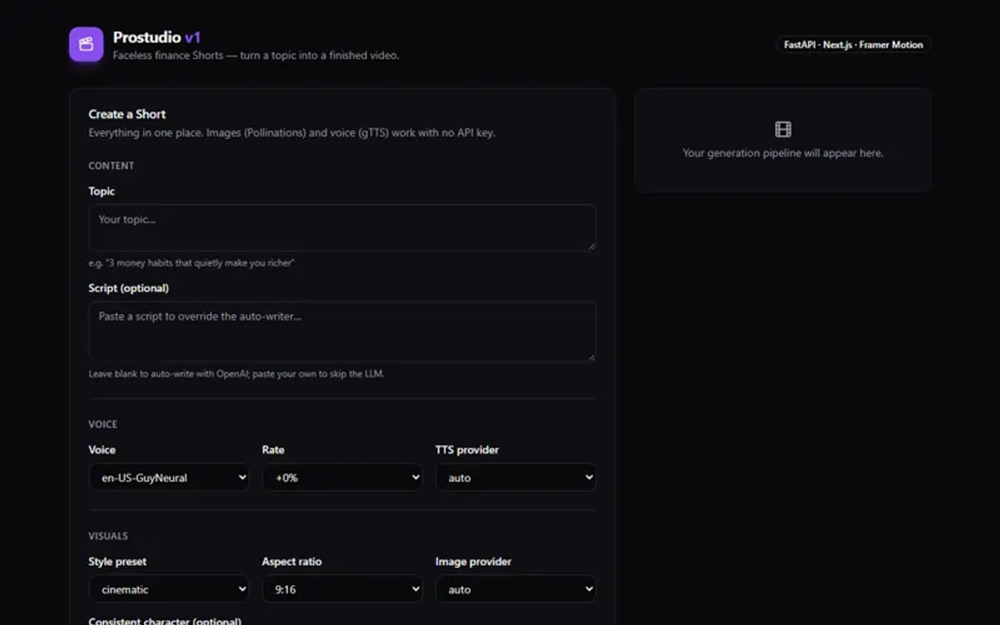

# ProstudioX-v1

<!-- about-me -->
## About me

  
  
  

**A V Ajay Kiran** — AI Growth & Digital Transformation Leader with 14+ years across AI
product development, SEO and performance marketing, UX strategy and workflow automation,
working with teams across India, Germany, the US and Australia.

**Certified:** HFI Certified User Experience Analyst (CXA) — Human Factors International.

**Capabilities**

- **AI & Growth** — Generative AI · LLM workflows · Prompt engineering · AI product development · AI content & video · Workflow automation · Growth strategy · SEO/SEM · Performance marketing · CRO · Go-to-market · Content strategy · Marketing automation
- **UX & Product** — UX strategy · User research · Information architecture · Wireframing & prototyping · Design systems · Usability testing · Product strategy
- **Engineering** — TypeScript · Python · React 19 · Next.js · Astro · FastAPI · Three.js · Tailwind CSS · PostgreSQL · Docker · Vite · Zustand
- **Analytics** — GA4 · Search Console · Looker Studio · Hotjar · Mixpanel · Microsoft Clarity · Google Ads · Semrush · Ahrefs

**Find me** — [LinkedIn](https://www.linkedin.com/in/aigrowthandautomationleader/) ·
[designjoom.com](https://designjoom.com) · [ajayspi@gmail.com](mailto:ajayspi@gmail.com)
